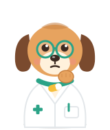
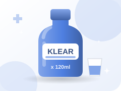
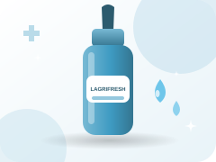
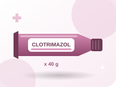
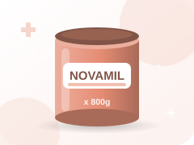
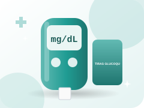
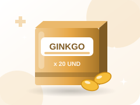

# Prompts del prototipo FarmaMatch

El entregable 3 pide «el prototipo (enlace o archivo), las imágenes usadas y los prompts con que
se generó». Este archivo reúne los prompts con que se generaron **la aplicación**, **la mascota
Dr. Pildo** y **las imágenes de los productos**. El registro completo del uso de IA en todo el
proyecto está en [`bitacora_ia.md`](bitacora_ia.md).

* **Herramienta:** Claude (Anthropic), en un proyecto de la aplicación de Claude, en español.
* **Contexto que tenía la IA:** el enunciado del proyecto (`Proyecto4.pdf`), el tutorial
  `recbooks.Rmd`, los datos y los resultados de las fases 1 a 7 ya calculados en R.
* **No se usó un generador de imágenes** (como DALL·E o Midjourney). Las imágenes y la mascota
  son **dibujos vectoriales (SVG) escritos como código R** por Claude. Por eso son reproducibles:
  `source("preparar_app.R")` las vuelve a crear idénticas.

---

## 1. La aplicación

### Prompts del equipo

Copiados tal como se escribieron, en orden:

1. > quiero que hagas el recomendador bien bonito, distinto y funcional
2. > hagamos las pruebas necesarias primero

   (La IA propuso hacer primero la evaluación formal de la Fase 7 para decidir qué recomendador
   usar en cada vista; este fue el sí del equipo.)
3. > sí

   (Aprobando pasar a la aplicación después de la Fase 7.)
4. > cambia el nombre, tipo, recommendapp o algo creativo. Y quiero que el diseño sea más lindo,
   > imagenes de los productos generadas por ti y que puedas, no sé, meter a Snoopy como
   > recomendador

### Especificación que siguió la IA

A partir de esos prompts y de los requisitos mínimos del enunciado, la IA trabajó con esta
especificación (está implementada en `app/app.R`, `app/www/estilo.css` y `preparar_app.R`):

* Aplicación **Shiny** que corra en RStudio con *Run App*, sin servidor externo.
* **Puente R → app:** `preparar_app.R` lee los `.rds` de las fases y exporta
  `app/datos_app.rds` y `app/recomendaciones.json`. La app solo consulta, así que responde de
  inmediato.
* **Vista «producto»:** buscar por **nombre** (no por código), con autocompletado. Mostrar el
  producto y sus recomendaciones del ítem–ítem con α = 0,25 (Fase 5) como tarjetas con imagen,
  descripción, barra de afinidad y la explicación «*X compradores de este producto también
  compraron este*». Separar las «otras presentaciones» del mismo producto.
* **Vista «comprador»:** elegir un comprador (o uno al azar) y ver su historial al lado de sus 10
  recomendaciones del usuario–usuario (Fase 6), **sin productos ya comprados**, con la explicación
  «*lo compraron N de los 50 compradores con compras más parecidas*».
* **«¿Cómo funciona?»:** el método y los resultados de la Fase 7 en lenguaje sencillo.
* **Nombre creativo:** se eligió **FarmaMatch** (se ofrecieron también PastillApp y Recetín).
* **Diseño:** cálido y amigable, paleta menta, coral y amarillo, tarjetas redondeadas,
  tipografías Fredoka y Nunito, que se entienda sin instrucciones y funcione en el celular.
* **Snoopy:** no se usó. Es un personaje con derechos de autor y el enunciado pide no inventar
  ni usar marcas ajenas. En su lugar, una mascota original (sección 2).

---

## 2. La mascota Dr. Pildo

**Prompt del equipo:** «*…que puedas, no sé, meter a Snoopy como recomendador*».

**Respuesta de la IA:** en lugar de Snoopy, diseñó un personaje propio, descrito así en
`app/mascota.R`:

> Un cachorro color caramelo con orejas chocolate, gafas redondas, bata de farmacéutico y una
> cápsula en el collar. Dibujado a mano en SVG para este proyecto (no está basado en ningún
> personaje existente). Tres expresiones: «feliz» (saluda), «pensando» (pata en el mentón) y
> «guiño».

| Feliz | Pensando | Guiño |
|:---:|:---:|:---:|
|  |  |  |

**Cómo se genera:** `mascota(expresion)` en `app/mascota.R` arma el SVG con formas simples
(elipses, círculos y trazos) y cambia solo los ojos, la boca y la pata según la expresión.
`dice(...)` lo pone junto a un globo de diálogo con el nombre «Dr. Pildo». En la app presenta las
recomendaciones («¡Guau! Olfateé las compras de los … compradores. Mi favorito para acompañarlo
es …»), marca su favorito con un sello en la primera tarjeta y aparece «pensando» cuando un producto no
tiene suficientes compras para recomendar.

---

## 3. Las imágenes de los productos

**Prompt del equipo:** «*imagenes de los productos generadas por ti*».

**Requisito del enunciado:** las imágenes «deben representar el producto con fidelidad
(presentación, forma farmacéutica) y no inventar marcas que no existen».

**Cómo se generaron:** la función `svg_producto()` de `preparar_app.R` dibuja una ilustración
vectorial por producto (732 archivos en `app/www/img/<Material>.svg`) a partir de **la
descripción del producto en las facturas**, con tres reglas:

1. **Forma farmacéutica** por palabras clave de la descripción (`reglas_forma`):

   | Dibujo | Palabras clave | Productos |
   |---|---|---|
   | caja | cualquier otro caso | 426 |
   | gomitas | GOMAS, GTS, MINIPACK, BOLSA, GUMIVIT | 70 |
   | líquido (jarabe, suspensión, solución) | JBE, JARABE, SUSP, LOCION, SOL, mL | 48 |
   | frasco | FCO, FRASCO | 45 |
   | tubo | CREMA, UNGU, POMADA, TUBO, GEL | 28 |
   | ampolla / inyectable | INY, AMP, JERINGA | 23 |
   | gotero | OFT, GOTAS, GOT | 21 |
   | glucómetro e insumos | TIRAS, LANCETA, GLUCOMETRO, AGUJA | 21 |
   | lata | LATA, TARRO | 18 |
   | sobres | SOBRE, SOB | 10 |
   | spray | AEROSOL, SPRAY | 8 |
   | mascarilla | TAPA BOCAS, PROTEKTA | 7 |
   | termómetro y dispositivos | TERMOMETRO, TENSI, BASCULA | 7 |

   En cajas y frascos se dibujan además **cápsulas** (si dice CBG, CAPS, CAPSULA o UNIGEL) o
   **tabletas** (en otro caso).
2. **Color** según una categoría terapéutica aproximada por palabras clave
   (`reglas_categoria`, 16 categorías, por ejemplo «Diabetes», «Ojos», «Piel»).
3. **Etiqueta** con el **nombre tal como aparece en las facturas** (primera palabra, o dos si es
   genérica, como «VITAMINA E») y el detalle de la presentación. No se dibujan logos, empaques
   reales ni marcas inventadas.

Ejemplos (los archivos están en `app/www/img/`):

| | | |
|:---:|:---:|:---:|
| <br>Klear Kids tos jarabe · *líquido* | <br>Lagrifresh sol. oftálmica · *gotero* | <br>Clotrimazol crema vaginal · *tubo* |
| <br>Novamil Premium 2 · *lata* | <br>Tiras GlucoQuick · *insumo de glucometría* | <br>Ginkgo Biloba 40 mg · *caja con cápsulas* |

**Correcciones durante el desarrollo:** la glucosamina quedaba como producto de diabetes por la
regla «GLUCO», así que se quitó esa regla y se añadió a dolor e inflamación; los nombres largos
se salían del empaque y se ajustó el tamaño de letra; se añadió la regla de sobres «SOB».

**Limitación:** son reglas de palabras clave. Pueden fallar con nombres poco comunes (un producto
sin palabra clave reconocible se dibuja como caja). 104 productos quedaron en la categoría «Otros».

---

## 4. Cómo volver a generar todo

Desde la raíz del proyecto, después de generar las fases (ver [README](README.md)):

```r
source("preparar_app.R")   # recrea app/datos_app.rds, app/recomendaciones.json y app/www/img/
shiny::runApp("app")       # abre FarmaMatch
```
