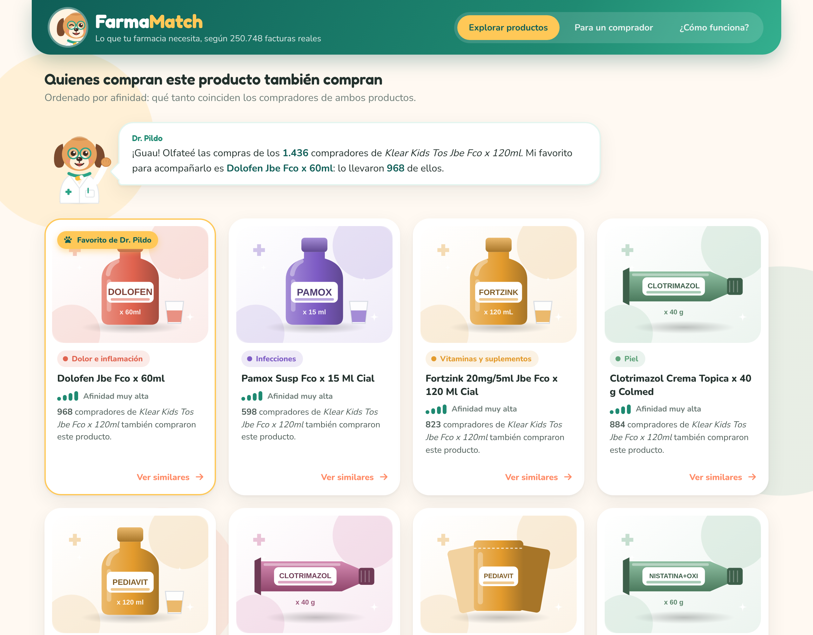

::: {custom-style="Portada Titulo"}
Proyecto 4: sistema de recomendación para un marketplace farmacéutico

(Procaps, 2013–2022)
:::

::: {custom-style="Portada"}
&nbsp;

&nbsp;

&nbsp;

&nbsp;

&nbsp;

&nbsp;
:::

::: {custom-style="Portada Etiqueta"}
Integrantes:
:::

::: {custom-style="Portada"}
María Mónica Murillo Rincón

Elias Jose Parra Royero

&nbsp;
:::

::: {custom-style="Portada Etiqueta"}
Docente:
:::

::: {custom-style="Portada"}
Enrique J. De La Hoz Domínguez

&nbsp;

&nbsp;

&nbsp;

&nbsp;

&nbsp;

&nbsp;

&nbsp;

&nbsp;

Facultad de Ingeniería

Programa de Ingeniería Industrial

Universidad del Magdalena

Estadística Industrial

Santa Marta, Magdalena

2026
:::

\newpage

```{r setup, include = FALSE}
knitr::opts_chunk$set(echo = FALSE, message = FALSE, warning = FALSE, dpi = 200)
library(ggplot2)
# Las cifras de este informe vienen de los documentos de cada fase (proyecto4_completo.html).
# El informe no recalcula nada, así que se genera en segundos.
```

# 1. Problema

Un marketplace farmacéutico quiere responder dos preguntas: cuando un comprador **mira un
producto**, ¿qué otros productos conviene mostrarle?, y cuando un comprador **entra a la
tienda**, ¿qué le recomendamos? La pregunta estadística detrás es cómo medir la similitud entre
productos y entre compradores con datos de compras, y cómo **demostrar** que las recomendaciones
son mejores que mostrar lo más vendido.

Partimos del tutorial de Ander Fernández, que construye en R tres recomendadores para libros
(contenido, ítem–ítem y usuario–usuario) con calificaciones explícitas de 1 a 10. Lo
reproducimos con la versión de Book-Crossing de Kaggle y lo adaptamos a las facturas de Procaps
(2013–2022), donde no hay calificaciones sino **cantidades compradas**.

# 2. Datos

Son dos archivos en Latin-1, separados por punto y coma, con el punto como separador de miles:
el detalle `pro2.csv` (una fila por línea de factura) y la cabecera `cab.csv` (una fila por
factura, con la fecha y el comprador `colaborador`).

**Unión.** `invoice` es única en la cabecera, así que la relación es de muchos a uno. Usamos
`left_join(detalle, cabecera, relationship = "many-to-one")`: dplyr fallaría si hubiera
cabeceras repetidas. Resultado verificado: **496.375 filas antes y después**, 0 líneas sin
comprador y 306 cabeceras sin detalle (facturas vacías, que quedan fuera a propósito).
Encontramos 51 códigos `Material` con dos descripciones (espacios, sufijo «CIAL»); armamos un
catálogo con la descripción más usada, que solo afecta los nombres que se muestran.

```{r tabla-datos}
knitr::kable(data.frame(
  Indicador = c("Líneas de factura", "Facturas", "Compradores", "Productos", "Periodo",
                "Cantidad por línea", "Productos por comprador",
                "Productos que suman el 50 % de las unidades"),
  Valor = c("496.375", "250.748", "5.888", "732", "julio 2013 – marzo 2022",
            "1 a 20, mediana 1 (67 % de las líneas es 1)",
            "mediana 22, máximo 267", "40 de 732 (Ginkgo Biloba solo: 8,7 %)")),
  caption = "**Tabla 1.** *Resumen de los datos unidos.*")
```

Dos rasgos guían todo lo demás: la matriz comprador × producto está **95 % vacía** (en los
libros del tutorial era 99,98 %), y las ventas están **muy concentradas**, de modo que cualquier
método ingenuo tiende a recomendar siempre el Ginkgo, la vitamina E o la nistatina.

# 3. Decisiones de adaptación

## 3.1 Reproducción del tutorial (Fase 1)

Con Kaggle cambian los nombres de archivos y columnas (`Books.csv`, `Rating`, sin URL de
carátulas) y leímos cada archivo por su nombre en lugar de por su posición. Al ejecutar el
código encontramos **dos errores reales**, que el Rmd muestra con el código original al lado del
corregido:

* `recomendar()` (contenido) unía la calificación por el libro recomendado y no por el leído;
  en el ejemplo, **8 de 8** candidatos eran libros que el usuario ya había leído.
* `item_recommendation()` buscaba el libro en `rownames` de una matriz cuyos libros están en las
  columnas: devolvía **42.151 NaN** y una tabla vacía.

Además, `top_n(10000)` no toma 10.000 usuarios sino las calificaciones empatadas en el valor
máximo, así que la matriz del tutorial queda en la práctica binaria. No es un error de código,
pero cambia la interpretación.

## 3.2 Del libro a la farmacia

```{r tabla-adaptacion}
knitr::kable(data.frame(
  `Tutorial` = c("Usuario", "ISBN", "Calificación 1–10", "0 = sin calificación",
                 "Vecinos con top_n (conserva empates)", "Excluye libros leídos"),
  `Farmacia` = c("colaborador (de cab.csv, unido por invoice)", "Material (con description)",
                 "log(1 + suma de cantidad)", "celda vacía = no lo compró",
                 "exactamente k = 50 vecinos", "excluye todo lo comprado en su historia"),
  `Por qué` = c("Está en otra tabla", "Nombre legible para el prototipo",
                "Preferencia implícita, sin techo: hay que comprimir la cola",
                "No comprar no significa que no le guste", "Resultado estable y comparable",
                "Pregunta guía de la Fase 6"),
  check.names = FALSE),
  caption = "**Tabla 2.** *Traducción del tutorial al marketplace.*")
```

## 3.3 Preferencia implícita (Fase 3)

Comparamos cuatro definiciones: suma de cantidad, número de facturas, binaria y
log(1 + cantidad). La suma va de 1 a 263 y en el coseno cada valor entra al cuadrado, así que
un mayorista puede decidir solo la similitud de un producto. Medimos qué parte de la norma de
cada producto aporta su mayor comprador: con la suma, **75 productos** dependen en más de la
mitad de un solo comprador; con log, 25; con la binaria, 10.

En una validación temporal rápida (entrenar hasta 2020, probar en 2021–2022) las cuatro
definiciones aciertan casi lo mismo (hit rate\@10 entre 65,4 % y 66,1 %, con intervalos
traslapados). Como el acierto no las separa, elegimos **log(1 + cantidad)**: conserva la
intensidad de compra que la binaria descarta y reduce a un tercio el problema del mayorista.

## 3.4 Similitud de coseno (Fase 4)

Escribimos la función de coseno y la validamos contra `lsa::cosine` en cinco pares de productos,
un par de compradores y la matriz completa de 732 × 732, que se precalcula con `crossprod`
(diferencia máxima de 2,5e-14, es decir, error de redondeo). Geométricamente, un coseno de 0,8 es un ángulo de unos
37° entre los vectores de compradores de dos productos: los compran casi las mismas personas en
proporciones parecidas. Fijamos en 0 la similitud de pares con **menos de 5 compradores en
común**: no cambia el acierto global, pero evita que un producto raro se recomiende por la
coincidencia de dos o tres personas.

## 3.5 Recomendador ítem–ítem (Fase 5)

Con el coseno puro, **28,4 %** de las recomendaciones de cualquier producto eran alguno de los
10 más vendidos: al clotrimazol vaginal le recomendaba Ginkgo y vitamina E. Añadimos una
**penalización de popularidad** solo para ordenar:

**puntaje de B para quien mira A = coseno(A, B) / (compradores de B)^α**, con α = 0,25.

Con α = 0,25 esa cuota baja a 3,8 % y el hit rate queda dentro del intervalo del coseno puro
(65,4 % frente a 66,2 %); con α = 0,5 se desploma a 6,5 % porque suben productos rarísimos.
Analizamos siete productos de categorías distintas. Con la penalización los primeros puestos son
del mismo uso terapéutico en los siete: a las tiras de glucosa les recomienda lancetas y glucómetro; al jarabe
Klear Kids, Dolofen jarabe, Pamox suspensión y Fortzink (el botiquín del niño enfermo); a
Lagrifresh, otras lágrimas artificiales. La debilidad que queda son las **variantes del mismo producto**
(Novamil 1, 2 y 3, de 400 y 800 g).

## 3.6 Recomendador usuario–usuario (Fase 6)

Normalizamos cada fila una vez, de modo que la similitud de un comprador con todos los demás es
un solo producto matriz–vector (respuesta inmediata). La puntuación de un producto es el
promedio de la preferencia de los k vecinos ponderado por su similitud, exigiendo que al menos
2 vecinos lo hayan comprado. **Verificamos la exclusión** para los 5.888 compradores, contra la
matriz y contra las facturas originales: 0 productos ya comprados. Sin el filtro, 9 de cada 10
recomendaciones del caso analizado serían productos que el comprador ya tenía.

En la grilla k ∈ {5, …, 200} × umbral ∈ {1, …, 10}, el acierto sube hasta k = 50 (66,6 %) y
luego se estanca, porque con muchos vecinos el promedio se acerca a «lo que compra todo el
mundo». Elegimos **k = 50 y umbral 2** (mismo acierto y 100 % de cobertura que el umbral 1, con
más respaldo por recomendación). Para no llenar la lista con presentaciones de lo mismo,
dejamos **un producto por familia** (primera palabra del nombre, dos si es genérica).

# 4. Resultados de la evaluación (Fase 7)

Todo se entrena con las compras hasta el 31/12/2020 y se prueba con 2021–2022. Se evalúan los
**2.568 compradores** presentes en ambos periodos. Un acierto es un producto recomendado que el
comprador compró en 2021–2022 y **no había comprado antes**. La línea base son los 10 productos
más vendidos hasta 2020, también sin los que el comprador ya tiene. Los hiperparámetros se
fijaron antes, sin mirar el periodo de prueba.

```{r tabla-eval}
res <- data.frame(
  modelo = c("Línea base: 10 más vendidos", "Ítem–ítem, coseno puro", "Ítem–ítem, α = 0,25",
             "Usuario–usuario, k = 50", "Usuario–usuario, una por familia"),
  hr = c(62.5, 65.3, 64.5, 65.6, 64.6), hr_inf = c(60.6, 63.4, 62.7, 63.8, 62.7),
  hr_sup = c(64.4, 67.1, 66.4, 67.4, 66.4),
  pr = c(11.09, 12.20, 12.17, 12.32, 12.01), pr_inf = c(10.64, 11.72, 11.68, 11.84, 11.53),
  pr_sup = c(11.53, 12.69, 12.63, 12.80, 12.47),
  p = c("—", "2,7e-06", "0,013", "4,2e-05", "0,012"),
  distintos = c(76, 115, 263, 166, 182))
f <- function(x, d = 1) formatC(x, format = "f", digits = d, decimal.mark = ",")
knitr::kable(data.frame(
  Modelo = res$modelo,
  hr_col = paste0(f(res$hr), " % [", f(res$hr_inf), "; ", f(res$hr_sup), "]"),
  pr_col = paste0(f(res$pr, 2), " % [", f(res$pr_inf, 2), "; ",
                                              f(res$pr_sup, 2), "]"),
  `p McNemar vs. base` = res$p,
  `Productos distintos` = res$distintos, check.names = FALSE) |>
    setNames(c("Modelo", "hit rate\\@10 (IC 95 % Wilson)", "precision\\@10 (IC 95 % bootstrap)",
               "p McNemar vs. base", "Productos distintos")),
  caption = "**Tabla 3.** *Evaluación temporal (2.568 compradores).*",
  align = c("l", "c", "c", "c", "c"))
```

::: {custom-style="Image Caption"}
**Figura 1.** *hit rate\@10 y precision\@10 con intervalos de confianza del 95 %.*
:::

::: {custom-style="Figure"}
```{r grafico-eval, fig.width = 6.5, fig.height = 2.4}
largo <- rbind(
  data.frame(modelo = res$modelo, m = "hit rate@10 (%)", v = res$hr, i = res$hr_inf, s = res$hr_sup),
  data.frame(modelo = res$modelo, m = "precision@10 (%)", v = res$pr, i = res$pr_inf, s = res$pr_sup))
largo$modelo <- factor(largo$modelo, levels = rev(res$modelo))
largo$base <- grepl("base", largo$modelo)
ggplot(largo, aes(v, modelo, color = base)) +
  geom_errorbarh(aes(xmin = i, xmax = s), height = 0.25) + geom_point(size = 2) +
  facet_wrap(~ m, scales = "free_x") +
  scale_color_manual(values = c(`TRUE` = "grey55", `FALSE` = "#1F8A72"), guide = "none") +
  labs(x = NULL, y = NULL) + theme_minimal(base_size = 9, base_family = "serif")
```
:::

**Conclusión.** Todos los recomendadores superan a la línea base de forma **estadísticamente
significativa** en las dos métricas: McNemar para el hit rate (pareado, porque los mismos
compradores reciben las dos listas) y bootstrap pareado y Wilcoxon para la precisión; ningún
intervalo de la diferencia en precision\@10 incluye el 0. La mejora es **modesta, de 2 a 3
puntos**, porque en un mercado tan concentrado «lo más vendido» ya acierta mucho. La diferencia
grande está en la **diversidad**: la línea base usa 76 productos distintos y casi la mitad de sus
recomendaciones son del top 10; el ítem–ítem con α = 0,25 usa 263 (36 % del catálogo) y solo
24 % del top 10. Es decir, personaliza sin perder acierto.

Por eso el prototipo usa **ítem–ítem con α = 0,25** en la vista «producto» y **usuario–usuario
con k = 50, mínimo 2 vecinos y una por familia** en la vista «comprador». Ambas aciertan un
punto menos que sus versiones puras, pero siguen superando a la línea base (p = 0,013 y 0,012) y
dan listas con más sentido farmacéutico.

# 5. Prototipo: FarmaMatch

Es una aplicación Shiny que corre en RStudio y lee las recomendaciones exportadas desde R
(`datos_app.rds` y `recomendaciones.json`), así que responde de inmediato.

* **Vista «producto»:** búsqueda por nombre con autocompletado, la
  ficha del producto y sus recomendaciones en tarjetas con imagen, barra de afinidad y la
  explicación «*X compradores de este producto también compraron este*». Las otras
  presentaciones del mismo producto se muestran aparte.
* **Vista «comprador»:** su historial al lado de sus 10 recomendaciones, con la garantía visible
  de que ninguna está en su historial y la explicación «*lo compraron N de los 50 compradores con compras más parecidas*».
* **Imágenes:** una ilustración por producto (732), dibujada por código según la forma
  farmacéutica que dice la descripción (caja, frasco, tubo, gotero, lata, sobres, spray,
  ampolla…) con el nombre tal como aparece en las facturas: no se inventan marcas ni empaques.
* **Dr. Pildo,** una mascota original, presenta las recomendaciones en lenguaje sencillo.

::: {custom-style="Image Caption"}
**Figura 2.** *Vista «producto» de FarmaMatch.*
:::

::: {custom-style="Figure"}
```{r captura, out.width = "85%"}

```
:::

# 6. Limitaciones

* **La mejora sobre la línea base es pequeña** en términos absolutos (2–3 puntos), aunque
  significativa. El valor práctico está más en la diversidad que en el acierto.
* **Se mide compra, no satisfacción.** Un producto no comprado pudo ser una buena sugerencia; y
  un producto comprado pudo haberse comprado de todos modos.
* **Arranque en frío.** Un comprador sin historial no recibe recomendaciones personalizadas, y
  los 60 productos lanzados después de 2020 no pueden recomendarse con filtrado colaborativo.
  Para ellos la línea base sigue siendo la mejor opción; un recomendador de contenido ayudaría.
* **La similitud no es farmacología.** Dos productos se parecen porque los compran las mismas
  personas, no por su acción terapéutica. No debe usarse para sugerir medicamentos con fórmula
  médica sin indicación profesional.
* **Reglas aproximadas.** Las familias (primera palabra) y las categorías y formas de las
  imágenes (palabras clave) son heurísticas: funcionan en la mayoría de los casos, no en todos.
* **Compradores muy distintos entre sí.** Algunos «colaboradores» compran como mayoristas
  (hasta 2.434 unidades y 267 productos distintos) y otros una sola vez. El log reduce el peso
  de los grandes, pero el recomendador mezcla patrones de surtido y de consumo.
* **Variantes.** El ítem–ítem sigue favoreciendo otras presentaciones del mismo producto; en la
  vista «producto» se separan, pero no se eliminan del cálculo.

# 7. Reproducibilidad y uso de IA

`proyecto4_completo.Rmd` ejecuta las siete fases en orden y genera `proyecto4_completo.html`;
cada fase existe también como Rmd independiente. `preparar_app.R` regenera los datos y las
imágenes de la aplicación desde los resultados de R. El uso de IA (Claude, de Anthropic) en el
código, la aplicación y las imágenes está registrado en `bitacora_ia.md`, con los prompts, lo
que se aceptó y lo que se corrigió.

# Referencias

::: {custom-style="Bibliography"}
Fernández, A. *Cómo programar un sistema de recomendación en R*.

Book-Crossing Dataset (Kaggle).

Wilson, E. B. (1927). Probable inference, the law of succession, and statistical inference.
*Journal of the American Statistical Association, 22*(158), 209–212.
:::
